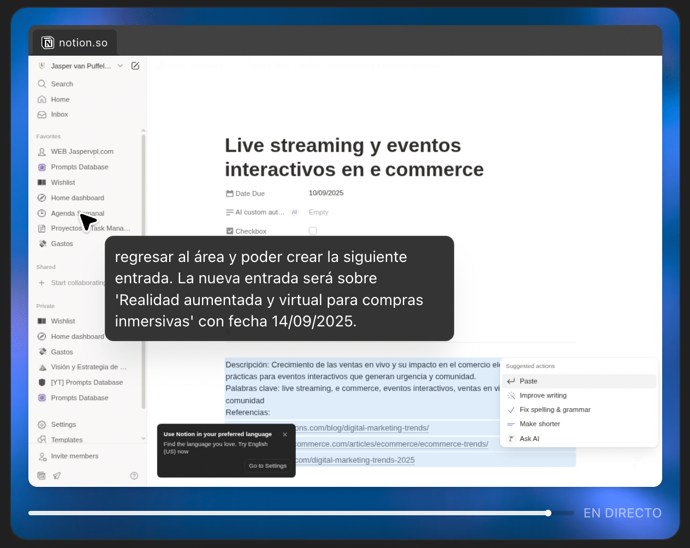

An **agent in ChatGPT** is an assistant that can plan, carry out multi-step tasks and remember context between sessions. It uses tools such as a visual browser, code execution, connectors and built-in memory.

## What can ChatGPT Agent do?

- Browses the web: clicks, types, downloads files and fills in forms.
- Runs code (code interpreter) to analyse data.
- Synthesises information from multiple sources (deep research).
- Creates spreadsheets, presentations and reports automatically.
- Connects to external services (Gmail, Notion, GitHub), always with the user's permission.
- Handles planning tasks such as content calendars or bookings, asking for confirmation before sensitive changes.

## How is it different from Operator?

> **Note from November 2026:** Operator no longer exists as a separate product, and OpenAI's Atlas browser shut down in August 2026. Their features moved into ChatGPT and Codex. The table shows the situation in August 2025.

| **Feature** | **Operator** | **ChatGPT Agent** |
| --- | --- | --- |
| **Launch** | January 2025 (Pro preview) | July 2025 for Pro/Plus/Team, later Enterprise/Education |
| **Visual browsing** | Yes (click, scroll, type in an isolated browser) | Yes, integrated with risk checks and a "watch" mode |
| **Research** | Limited | Advanced, with deep synthesis and report generation |
| **Autonomy** | Carries out specific tasks | Plans and runs complete workflows on its own |
| **Memory/context** | No | Yes, keeps context between tasks and sessions |
| **Risk and safety** | Simple confirmations, limited to browsing | Watch mode, blocks, auditing and confirmations for critical tasks |

## My experience using ChatGPT Agent

Recently, I used the agent to create a content calendar for my personal blog: one topic every three days, over three months. The ChatGPT agent started by searching the web for topics to publish. It then gathered them in a spreadsheet and added them to my personal Notion, specifically to my weekly agenda.

With this approach I got a three-month publishing calendar. My Notion was only updated after my approval, and I could review and correct each step in real time before the agent applied the changes.

## Conclusion

- ChatGPT Agent is the **natural evolution of Operator**, combining web browsing and deep research.
- Its autonomy makes it useful for complex tasks, but always with your control and continuous validation.
- My test with Notion showed it works safely, efficiently and collaboratively, with you at the centre.

Learn more here: [https://openai.com/index/introducing-operator/](https://openai.com/index/introducing-operator/)
