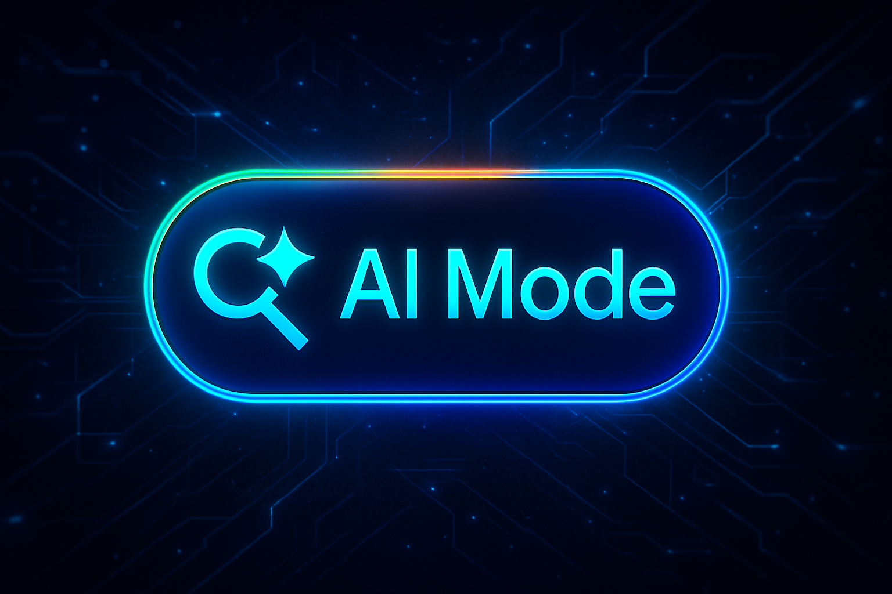

**Google AI Mode** marks a turning point in how we interact with search engines. It adds a layer of intelligence that makes the search experience more conversational, personalised and efficient. With its gradual roll-out, we are seeing the start of a new era in the digital world.

In this guide you will find out **what AI Mode is**, when it will be available in more countries, how it may affect **SEO**, and what opportunities it opens up for people who create digital content.

## What is Google AI Mode? Features and benefits

The new AI Mode is designed to give deeper, more complete and more contextual answers, combining traditional search with AI-generated text. Its main features include:

- **Multimodal interaction**: it combines text, images and other content in its answers.
- **Contextual reasoning**: it gives results based on search history and user intent.
- **Conversational answers**: searching feels like a fluid chat.
- **Information synthesis**: it summarises several sources in one structured answer.
- **Task automation**: it lets you act directly from the search, such as drafting emails or planning events.

The aim is to reduce the time users spend comparing sources or digging deeper on their own, by giving results that feel much closer to a human answer.

## When will it roll out worldwide, and where is it active now?

At the moment, **Google AI Mode** has started rolling out in the United States as a pilot market. This first phase will be used to tune the system before a wider expansion.

The roadmap already includes a gradual extension to other regions, with a focus on **Europe** and parts of Asia. There is no final date yet, but AI Mode is expected to reach more countries in the second half of the year. Its activation depends on factors such as local privacy law, data infrastructure and language support.

## Possible downsides for SEO

Despite the excitement, it is not all good news for those who rely on **SEO** as their main source of traffic. Some of the potential risks:

- **Loss of visibility**: AI-generated answers could replace clicks to traditional websites.
- **Lower CTR**: especially for informational queries, where users may not need to visit other pages.
- **Less control over the content shown**: the sources behind the answers are not always clearly identified.
- **More competition for authority**: showing experience, expertise, authority and trust (E-E-A-T) will matter more than ever.
- **Algorithmic uncertainty**: constant changes in how results are shown make long-term planning harder.

For a closer look at this impact, see [how AI-generated answers affect CTR](/writing/google-ai-overviews-ctr/), where we explore the consequences in real settings.

## Opportunities for SEO

Far from being an insurmountable obstacle, **Google AI Mode** can also become a strategic ally if you understand how it works. Some notable opportunities:

- **Optimising for synthesised results**: well-structured, highly informative content has a better chance of being included in the answers.
- **A focus on evergreen, educational content**: ideal for feeding AI models with lasting, well-contextualised content.
- **Strategies based on entities and semantic relationships**: they help algorithms understand what the site is about.
- **Structured data matters more**: it is key to standing out from other sources.
- **Adapting to a conversational style**: writing for AI means understanding how answers are generated, putting clarity, context and connection first.

There is also an interesting field around tools such as **Gmail** or **Gemini**, which could integrate with this assisted search to automate tasks in seconds, from drafting messages to analysing documents or scheduling meetings.
