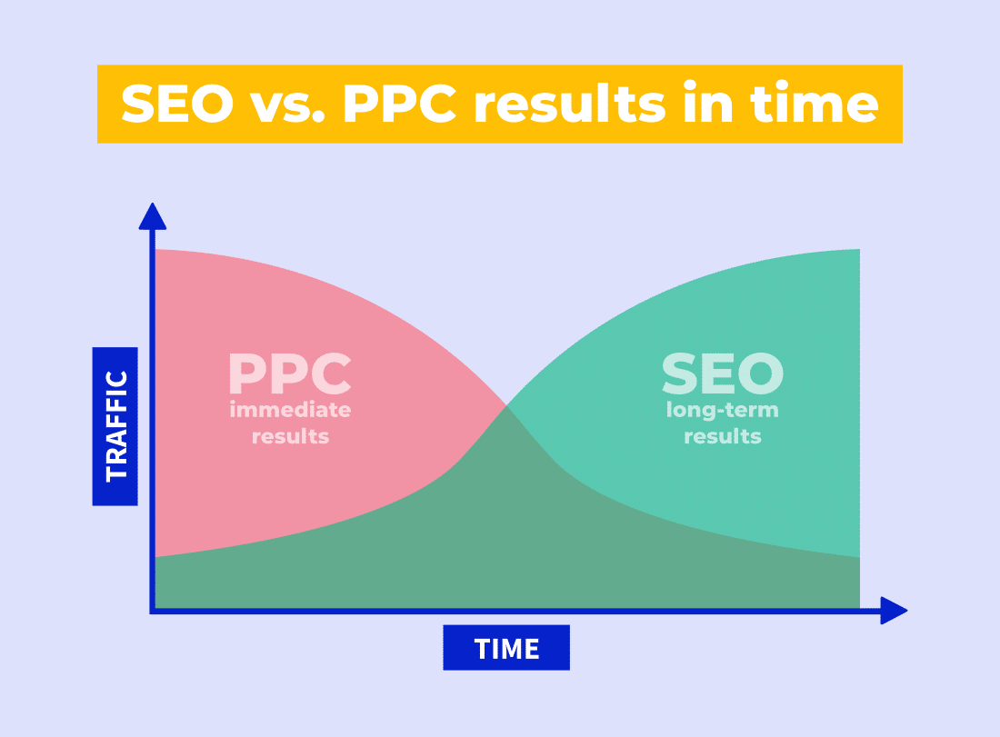

SEO (search engine optimisation) and SEM (search engine marketing) are two terms that are often confused or used interchangeably. In reality, they refer to different digital marketing strategies, both used to improve a website's visibility in search engines.

SEO focuses on optimising a website so that search engines find it more attractive, with the goal of appearing at the top of the organic search results. This is done with techniques such as keyword optimisation, creating high-quality content and link building.

SEM, on the other hand, focuses on promoting a website through paid ads in the search results. These ads appear at the top and/or side of the results and are a fast, effective way to increase a website's visibility.

The advantages of SEO include more organic traffic in the long term and a better user experience. The advantages of SEM include more precise control over visibility and budget, and faster results.

In general, you can use both SEO and SEM effectively to improve a website's visibility in search engines. The choice depends on your specific marketing goals, your budget and the time you have.

In short, SEO and SEM are complementary strategies that aim to improve a website's ranking in search engines such as Google or Yandex. Each has its own advantages and can be used to reach different goals. What matters is understanding the differences between them and using them strategically to get the best possible results.

Personally, I specialise in SEO. In fact, it is what I do in my job: optimising different websites so they gain authority and presence online. Feel free to [get in touch](/#contact) if you have any questions.
