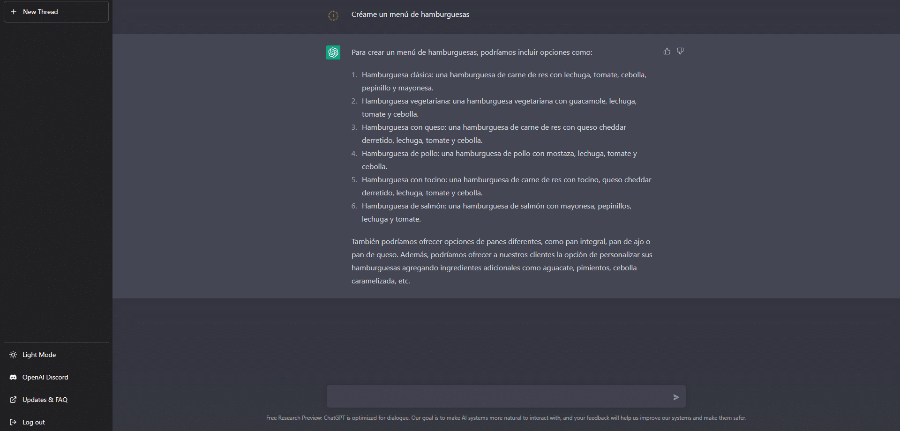

In the last few weeks, several artificial intelligence tools have opened up to the public. The one that caught my attention most is the one I am going to tell you about: ChatGPT.

ChatGPT is a language model created by OpenAI. It is a tool that can generate text on its own, **imitating natural human language**. It has been trained on a huge amount of data and can be used to help customers in several ways.

One of ChatGPT's main features is that it can answer questions quickly and accurately. If a customer has a question about a product or service, ChatGPT can give a precise, detailed answer in seconds. That saves time and effort for both the customer and the support team. Knowing this, I asked it to put together a detailed menu with several burgers:

So if you want to open a burger bar, you're welcome!

Another way ChatGPT can help customers is with personalised assistance. Because it can generate text on its own, ChatGPT can adapt to each customer's needs and give relevant, accurate information and advice. That can improve the customer experience and satisfaction.

Knowing what this tool can do, and how lazy I am, I asked it to create a trivia game, since my family and I usually play board games at Christmas.

As you can see, it is a very useful tool, and I have only used it for fairly simple questions. This is just the beginning for ChatGPT: the more time passes and the more active users it has, the better its answers will be.

ChatGPT can also make a support team more efficient. By freeing human agents from repetitive, low-value tasks such as answering frequently asked questions, ChatGPT lets the team focus on more important work. That can improve the team's productivity and efficiency.

This sounds great for us, since technology helps us automate processes and generally makes life more comfortable. But it also raises a big problem: tools like this will take away many people's jobs.

I also think we should keep an eye on Google's next move. As the most used search engine in the world, we could soon see it launch its own artificial intelligence.

If you are curious, here is the link so you can try it yourself: [ChatGPT](https://chat.openai.com/chat).
