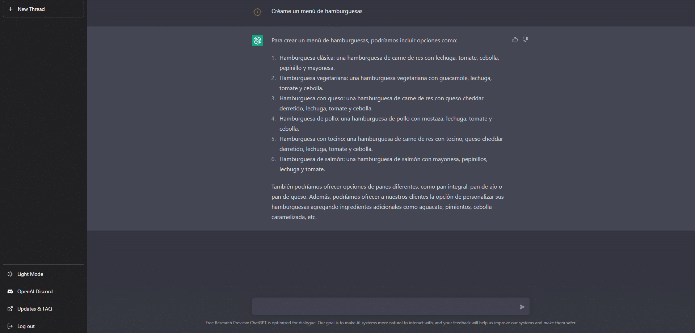
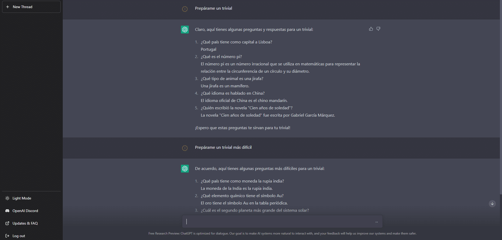

De afgelopen weken zijn er verschillende AI-tools voor het publiek opengesteld. De tool die mij het meest opviel, is de tool waar ik je nu over vertel: ChatGPT.

ChatGPT is een taalmodel van OpenAI. Het is een tool die zelfstandig tekst kan genereren en daarbij **natuurlijke menselijke taal nabootst**. Het is getraind op een enorme hoeveelheid data en kan klanten op verschillende manieren helpen.

Een van de belangrijkste functies van ChatGPT is dat het snel en nauwkeurig vragen kan beantwoorden. Heeft een klant een vraag over een product of dienst, dan geeft ChatGPT binnen een paar seconden een precies en gedetailleerd antwoord. Dat bespaart tijd en moeite, voor de klant en voor het supportteam. Met dat in gedachten vroeg ik het om een uitgebreid menu met verschillende hamburgers:

Dus als je een hamburgerrestaurant wilt beginnen: graag gedaan!

Een andere manier waarop ChatGPT klanten kan helpen, is met persoonlijke hulp. Omdat het zelfstandig tekst genereert, kan ChatGPT zich aanpassen aan de behoeften van elke klant en relevante, nauwkeurige informatie en adviezen geven. Dat kan de klantervaring en -tevredenheid verbeteren.

Omdat ik wist wat deze tool kan, en hoe lui ik ben, vroeg ik het om een trivia-spel te maken. Met kerst spelen mijn familie en ik namelijk vaak bordspellen.

Zoals je ziet, is het een erg handige tool, en dan heb ik het nog maar voor vrij eenvoudige vragen gebruikt. Dit is pas het begin voor ChatGPT: hoe meer tijd er verstrijkt en hoe meer actieve gebruikers het heeft, hoe beter de antwoorden worden.

ChatGPT kan een supportteam ook efficiënter maken. Door medewerkers te ontlasten van repetitieve taken met weinig toegevoegde waarde, zoals het beantwoorden van veelgestelde vragen, kan het team zich richten op belangrijker werk. Dat kan de productiviteit en efficiëntie van het team verbeteren.

Dit klinkt goed voor ons, want technologie helpt ons processen te automatiseren en maakt ons leven over het algemeen makkelijker. Maar het brengt ook een groot probleem met zich mee: dit soort tools gaat het werk van veel mensen overnemen.

Ik denk ook dat we de volgende zet van Google in de gaten moeten houden. Als meest gebruikte zoekmachine ter wereld zou Google binnenkort met een eigen AI kunnen komen.

Ben je nieuwsgierig? Hier is de link, zodat je het zelf kunt proberen: [ChatGPT](https://chat.openai.com/chat).
