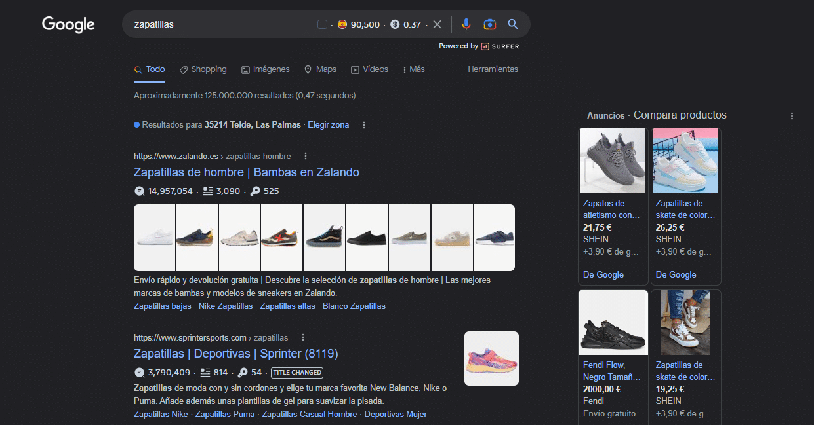
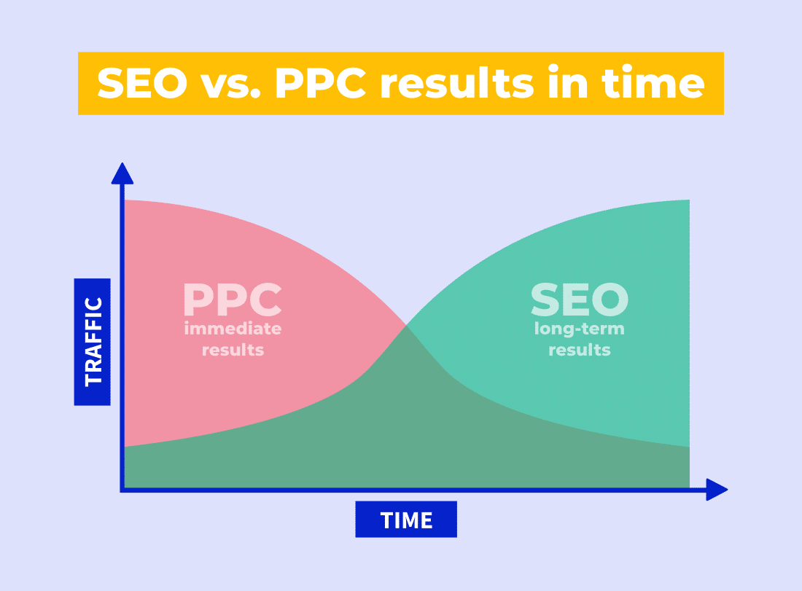

SEO (zoekmachineoptimalisatie) en SEM (zoekmachinemarketing, in Nederland meestal SEA genoemd) zijn twee termen die vaak door elkaar worden gehaald of als synoniemen worden gebruikt. In werkelijkheid gaat het om verschillende strategieën binnen online marketing, die allebei de zichtbaarheid van een website in zoekmachines vergroten.

SEO richt zich op het optimaliseren van een website zodat zoekmachines hem aantrekkelijker vinden, met als doel bovenaan in de organische zoekresultaten te komen. Dat doe je met technieken als zoekwoordoptimalisatie, het maken van kwalitatief goede content en linkbuilding.

SEA richt zich daarentegen op het promoten van een website met betaalde advertenties in de zoekresultaten. Die advertenties staan bovenaan en/of naast de resultaten en zijn een snelle, effectieve manier om de zichtbaarheid van een website te vergroten.

De voordelen van SEO zijn meer organisch verkeer op de lange termijn en een betere gebruikerservaring. De voordelen van SEA zijn meer controle over zichtbaarheid en budget, en snellere resultaten.

Over het algemeen kun je SEO en SEA allebei effectief inzetten om de zichtbaarheid van een website in zoekmachines te verbeteren. De keuze hangt af van je marketingdoelen, je budget en de tijd die je hebt.

Kortom: SEO en SEA zijn aanvullende strategieën die de positie van een website in zoekmachines als Google of Yandex verbeteren. Elk heeft zijn eigen voordelen en past bij andere doelen. Het belangrijkste is dat je de verschillen begrijpt en ze strategisch inzet voor het beste resultaat.

Persoonlijk ben ik gespecialiseerd in SEO. Dat is ook wat ik in mijn werk doe: verschillende websites optimaliseren zodat ze meer autoriteit en online aanwezigheid krijgen. Neem gerust [contact met me op](/nl/#contact) als je vragen hebt.
